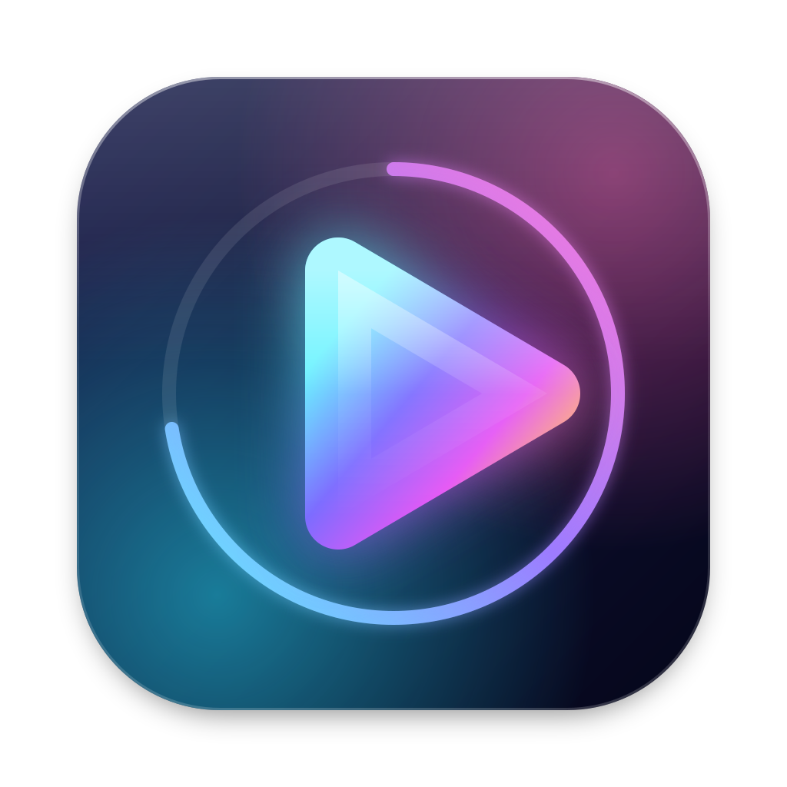
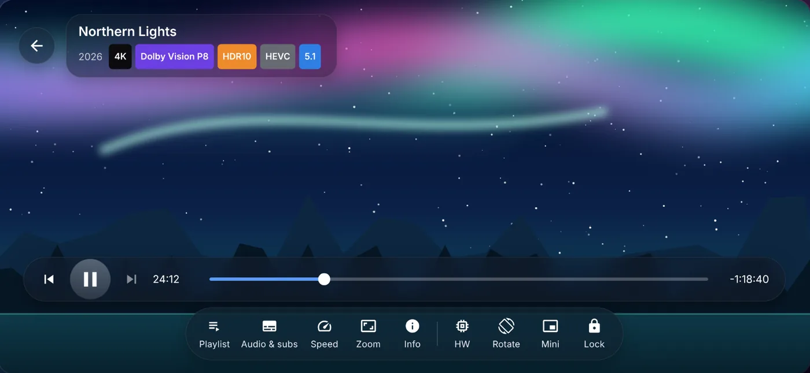

<p align="center"></p>

<h1 align="center">RokaPlayer</h1>
<p align="center"><b>Play 4K HDR and Dolby Vision movies with cinema sound. Fast and simple.</b><br>
For Mac (Apple Silicon) and Android.</p>

<p align="center">
  <a href="https://github.com/lokeshmagar000/Rokaplayer/releases/latest/download/RokaPlayer-Mac.dmg"><b>⬇ Download for Mac (.dmg)</b></a> ·
  <a href="https://github.com/lokeshmagar000/Rokaplayer/releases/latest/download/RokaPlayer-Android.apk"><b>⬇ Download for Android (.apk)</b></a> ·
  <a href="https://rokaplayer-da765.web.app">Website</a>
</p>

<p align="center"></p>

## Features
- **True HDR & Dolby Vision** — HDR10, HDR10+, HLG, Dolby Vision; hardware or software decoding
- **Big MKV files open in about a second**, with every audio and subtitle track
- **Cinema sound** — Dolby Digital, DD+, TrueHD, DTS, DTS-HD, plus an equaliser
- **Smart library** with posters, Continue watching and format badges
- **Wave seek bar** with chapter marks and picture preview
- **Skip intro & credits**, chapters, sleep timer
- **8 subtitle styles**, Blu-ray original styles, Smart SDH
- **Offline AI subtitles** (Whisper) made on your device — nothing is uploaded
- **Your languages remembered** for audio and subtitles
- **PC / NAS (SMB) & Jellyfin**, **Cast to TV**
- **Liquid Glass** look with themes, a transparency slider and editable control buttons
- Google sign-in to continue on another device · Free with ads, Premium removes them

## Requirements
| Mac | Android |
|---|---|
| macOS 15 or newer, Apple Silicon (M1 and later) | Android 8.0 or newer — phone, tablet, Android TV |

## Install
**Mac:** open `RokaPlayer-Mac.dmg` and drag RokaPlayer to Applications. The first time, macOS may say it can't check the app: open **System Settings → Privacy & Security** and click **Open Anyway**.
If it says the app is “damaged”, run this in Terminal:
```
xattr -dr com.apple.quarantine /Applications/RokaPlayer.app
```

**Android:** download `RokaPlayer-Android.apk`, tap it, allow your browser to *install unknown apps*, then tap **Install**. RokaPlayer is coming to Google Play soon.

## Privacy
Your videos never leave your device. Read the [privacy policy](https://rokaplayer-da765.web.app/privacy.html) · [licences](https://rokaplayer-da765.web.app/licenses.html).

---
Made with care in Nepal by **Lok Bahadur Roka Magar** · [Facebook](https://www.facebook.com/iamlokeshmagar) · [Instagram](https://www.instagram.com/iamlokeshmagar) · [TikTok](https://www.tiktok.com/@lokeshmagar000) · lokeshmagar000@gmail.com

<sub>Dolby, Dolby Vision and Dolby Digital are trademarks of Dolby Laboratories. DTS is a trademark of DTS, Inc. RokaPlayer is not made by or linked with them.</sub>
