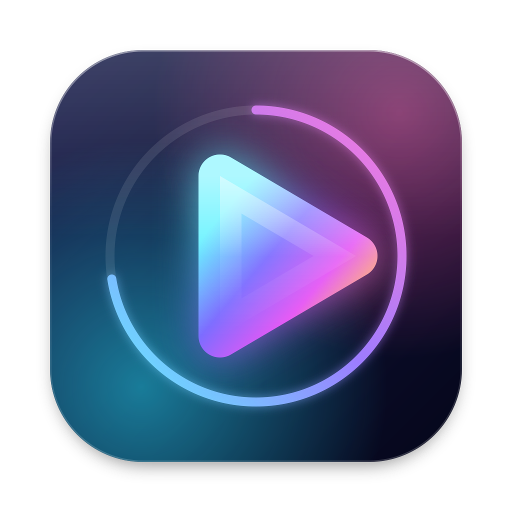
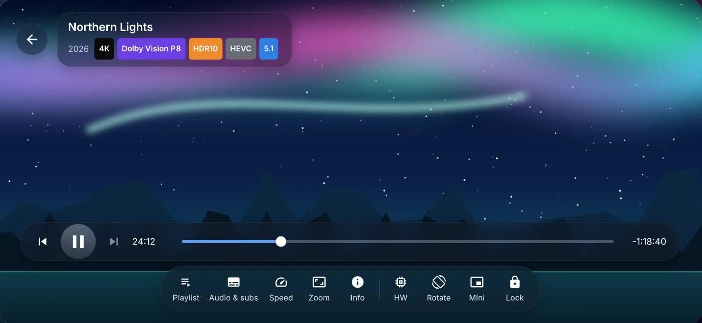

<p align="center"></p>

<h1 align="center">RokaPlayer</h1>
<p align="center"><b>Your cinema, everywhere.</b><br>
Play 4K HDR and Dolby Vision movies with cinema sound. Fast, beautiful and simple.</p>

<p align="center">
  
  
  
</p>

<p align="center">
  <a href="https://github.com/lokeshmagar000/Rokaplayer/raw/main/download/RokaPlayer-Mac.dmg"><b>⬇ Download for Mac</b></a> &nbsp;·&nbsp;
  <a href="https://github.com/lokeshmagar000/Rokaplayer/raw/main/download/RokaPlayer-Android.apk"><b>⬇ Download for Android</b></a> &nbsp;·&nbsp;
  <a href="https://rokaplayer-da765.web.app"><b>🌐 Website</b></a>
</p>

<p align="center"></p>

## ✨ Features

| | |
|---|---|
| 🎬 **True HDR & Dolby Vision** | HDR10, HDR10+, HLG and Dolby Vision, with hardware or software decoding |
| ⚡ **Opens big files fast** | Large MKV files open in about a second, with every audio and subtitle track |
| 🔊 **Cinema sound** | Dolby Digital, DD+, TrueHD, DTS, DTS-HD, plus an equaliser |
| 📚 **Smart library** | Posters, Continue watching and format badges |
| 〰️ **Wave seek bar** | Chapter marks and picture preview as you scrub |
| ⏭️ **Skip intro & credits** | Plus chapters and a sleep timer |
| 💬 **Beautiful subtitles** | 8 styles, original Blu-ray styles and Smart SDH |
| 🎙️ **Offline subtitles** | Created on your device with Whisper speech recognition — nothing is uploaded |
| 🌍 **Remembers your languages** | For audio and subtitles |
| 🖥️ **PC, NAS (SMB) & Jellyfin** | Stream from your own server, then **Cast to TV** |
| 🪟 **Liquid Glass design** | Themes, a transparency slider and editable control buttons |
| ☁️ **Sync** | Google sign-in to continue on another device · Free with ads, Premium removes them |

## 💻 Requirements

| Mac | Android |
|---|---|
| macOS 15 or newer, Apple Silicon (M1 and later) | Android 8.0 or newer — phone, tablet, Android TV |

## 📦 Install

**Mac:** open `RokaPlayer-Mac.dmg` and drag RokaPlayer to Applications. The first time, macOS may say it can't check the app: open **System Settings → Privacy & Security** and click **Open Anyway**.
If it says the app is “damaged”, run this in Terminal:
```
xattr -dr com.apple.quarantine /Applications/RokaPlayer.app
```

**Android:** download `RokaPlayer-Android.apk`, tap it, allow your browser to *install unknown apps*, then tap **Install**. RokaPlayer is coming to Google Play soon.

## 🔒 Privacy

Your videos never leave your device. Read the [privacy policy](https://rokaplayer-da765.web.app/privacy.html) · [licences](https://rokaplayer-da765.web.app/licenses.html).

---

<p align="center">
  Made with ❤️ in Nepal by <b>Lok Bahadur Roka Magar</b><br>
  <a href="https://www.facebook.com/iamlokeshmagar">Facebook</a> ·
  <a href="https://www.instagram.com/iamlokeshmagar">Instagram</a> ·
  <a href="https://www.tiktok.com/@lokeshmagar000">TikTok</a> ·
  lokeshmagar000@gmail.com
</p>

<sub>Dolby, Dolby Vision and Dolby Digital are trademarks of Dolby Laboratories. DTS is a trademark of DTS, Inc. RokaPlayer is not made by or linked with them.</sub>
